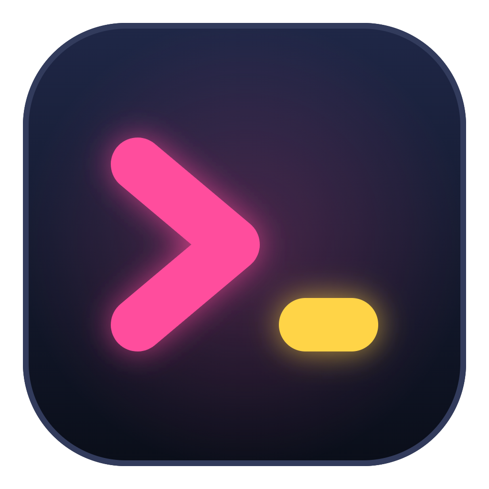
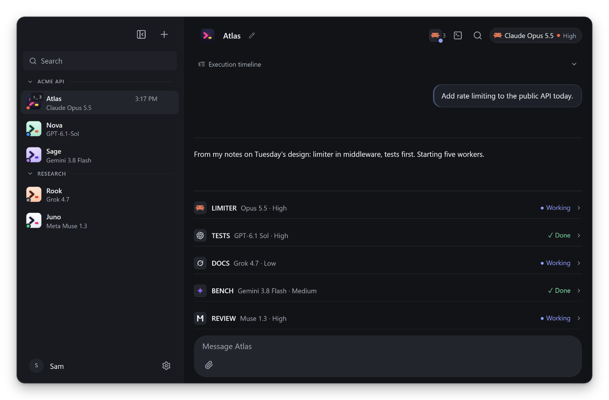
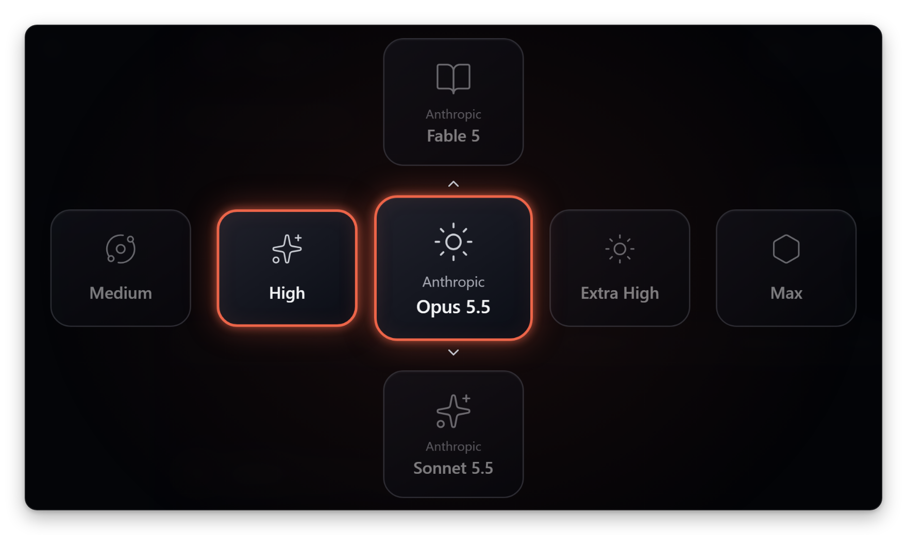
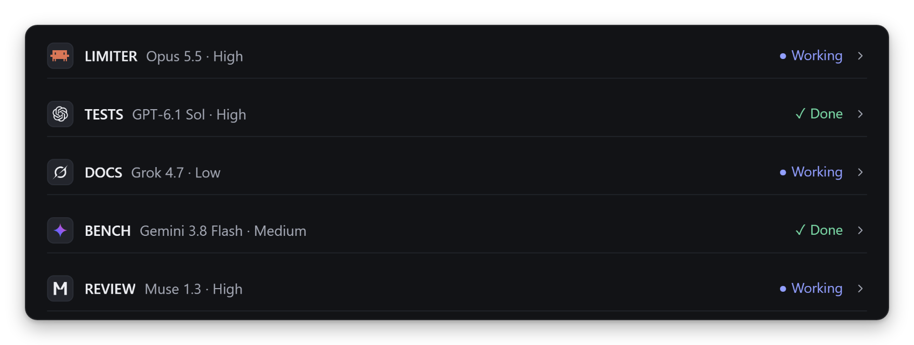
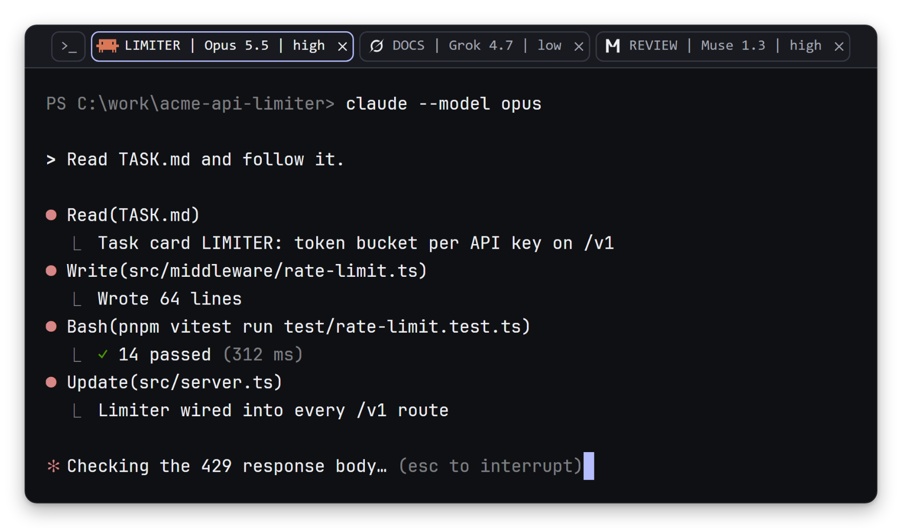
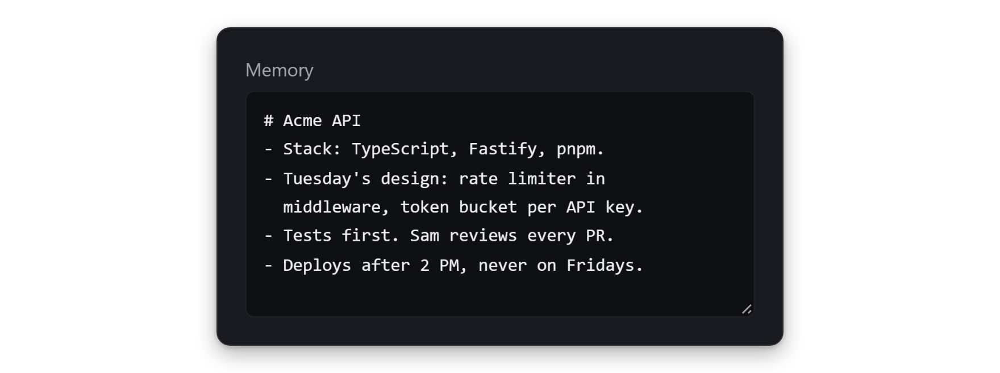
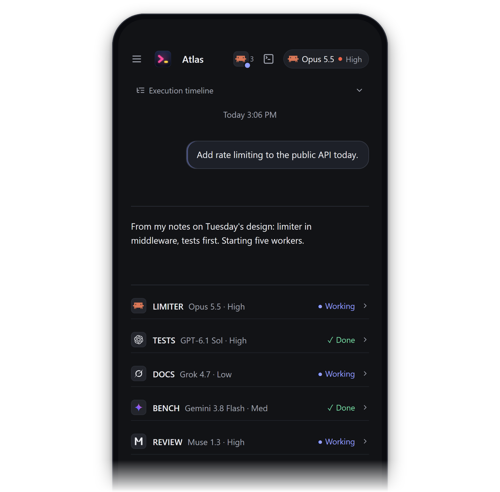

<h1 align="center">
  <br>
  Wink
</h1>

<p align="center">
  <a href="https://github.com/aiedwardyi/Orbit/actions/workflows/ci.yml"></a>
  <a href="https://github.com/aiedwardyi/orbit-releases/releases/latest"></a>
  <a href="LICENSE"></a>
</p>

<p align="center">
  Your AI coding subscriptions, in one desktop app, at terminal speed.
  <br>
  Runs on the Claude Code, Codex, Gemini, Grok and Muse logins you already have. No API keys. No analytics.
</p>

<p align="center">
  <a href="https://github.com/aiedwardyi/orbit-releases/releases/latest/download/Wink-setup.exe"><b>Download for Windows</b></a> (10 / 11, x64) · <a href="https://github.com/aiedwardyi/orbit-releases/releases">All releases</a>
  <br>
  Built by <a href="https://github.com/aiedwardyi">Edward Yi</a>
</p>



## Tour

**1. Every coding subscription you pay for**<br>
Give each bot its own engine and model. `Alt+M` switches mid-thread, and the thread carries over.



**2. A lead bot runs your workers**<br>
Ask once. It splits the job, picks each worker's engine, model and effort, and checks the work before it lands.



**3. Real terminals, one tab per worker**<br>
Each worker runs its engine's own CLI in a separate git worktree. Press `` Ctrl+` `` to drive it yourself.



**4. Never loses the plot**<br>
One thread per bot. No `/compact`, no starting over. Each bot's `MEMORY.md` carries across models, PCs and your phone.



**5. The same chats on your phone**<br>
Over your Tailscale tailnet or a [relay you host](relay/README.md), with a push when a bot needs you.

<p align="center">
  
</p>

## Quickstart

1. Install at least one [engine CLI](#engines) and sign in once.
2. Download **[Wink-setup.exe](https://github.com/aiedwardyi/orbit-releases/releases/latest/download/Wink-setup.exe)** and run it (Windows 10 / 11, x64).
3. Wink finds the engines on this PC. Create a bot, give it a job, and message it like anyone else.

The installer isn't code-signed yet, so SmartScreen may say "Windows protected your PC". Choose **More info**, then **Run anyway**.

## Engines

| Engine | CLI | Sign in |
|---|---|---|
| Claude Code | `claude` | `claude` |
| Codex | `codex` | `codex login` |
| Gemini (Antigravity) | `agy` | `agy` |
| Grok | `grok` | `grok login` |
| Muse | `muse` | `muse login` |

Install on Windows (PowerShell):

```powershell
irm https://claude.ai/install.ps1 | iex                  # Claude Code
npm install -g @openai/codex                             # Codex (needs Node.js)
irm https://antigravity.google/cli/install.ps1 | iex     # Gemini (Antigravity)
irm https://x.ai/cli/install.ps1 | iex                   # Grok
powershell -NoProfile -ExecutionPolicy Bypass -Command "irm https://api.meta.ai/muse-launcher.ps1 | iex"   # Muse
```

Engine logins stay in each CLI's own store. Wink drives the CLI with the session you already have. Add engines later in **Settings > Connections**. Muse runs natively and falls back to WSL.

## Trust and security

- No analytics. Error reports are off by default.
- Listens on this PC only, behind a per-launch token.
- Engine logins stay in each CLI's own store.

<details>
<summary>Everything Wink listens on, sends and stores</summary>

Wink has no analytics. This is everything it listens on, sends and stores.

**Listens** (this PC only)

- `127.0.0.1:8799` for the app (falls back to 18799, then 28799), behind a per-launch token and a Host/Origin check. The token lives in memory, and in a Claude turn's temp config until that turn ends.
- `127.0.0.1:8800` for webhooks (the app's port + 1, so 18800 or 28800 on a fallback), which rejects any request without a webhook's secret.
- Random token-protected `127.0.0.1` ports for the terminal and browser bridges.

**Sends with no setup**

- Update checks to GitHub Releases (`aiedwardyi/orbit-releases`) 15 s after launch, then hourly. The stock updater adds a random per-install ID header (`x-user-staging-id`) for staged rollouts. Downloads start only when you press the button and are checked against the release's sha512 hash. The build isn't code-signed yet.
- Your engine CLIs, which Wink starts to list models and check sign-in at launch, on refocus and in the model picker. Each talks to its own vendor with your login and keeps its own telemetry settings.
- `tailscale serve --bg --https=443` at launch when Tailscale is installed and logged in, so your phone can reach Wink over your tailnet. Tailnet only, never Funnel, and the API still needs the phone link's sign-in key. The rule stays after Wink quits. `ORBIT_REMOTE_AUTO=0` turns it off.
- Electron's built-in spellchecker, which can fetch a dictionary for your language from Google's Chromium CDN.

**Sends once you set something up**

- Opt-in error reports go to the GlitchTip host in the build's `ERROR_REPORT_DSN` (no host is configured in this repo), at most 5 uploads per PC per UTC day, off by default. They contain only app version, OS/architecture, fixed process/error/site codes, bounded counts/exit codes/uptime bucket, UTC hour and a random report ID. The host sees the PC's IP address.
- Phone relay, after you paste a setup code: a connection to your relay at every launch. TLS runs end to end between phone and PC, so the relay passes bytes it can't read. Wink also gets this PC's certificate from Let's Encrypt and checks crt.sh daily for certificates issued for its relay name.
- Phone notifications, once you allow them on the phone, go out encrypted through the phone browser's push service.
- Sync writes only to the folder you choose.
- Services you add a key for (Composio, ElevenLabs, AssemblyAI, the xAI API, Box (ascii.dev), OpenAI images, and custom providers in your Codex config) are called with that key when you or a bot use them. Composio is also called at every launch once its key is set, and each custom Codex provider is asked for its model list at launch.

**Sends only when you act**

- **Settings > Usage > Refresh** calls Anthropic's usage API with your Claude Code login. If that login expired, Wink renews it with Anthropic and rewrites `~/.claude/.credentials.json`.
- Team Library fetches a pinned snapshot of `milind-soni/openmausbot-teams` from GitHub. Skill import and install links also fetch from GitHub. Project scout queries `api.botdirectory.ai`. The Connected Apps panel loads app icons from Google's favicon service.
- Local VM and VPS setup pull images from Docker Hub and packages from PyPI, and reach your VPS over ssh.
- Images in a bot's reply load from wherever they point (there is no CSP), so a reply can make Wink fetch any URL.

**Stores**

- `~/.orbit` (or `OMB_DATA_DIR`): bots, chats (`messages.db`), each bot's `MEMORY.md`, task records, attachments, redacted engine event logs, phone pairing keys, a decision log, and checkpoints (a shadow git snapshot before each turn in a project folder). `orbit-msg` lives in `~/.orbit/bin`.
- `%APPDATA%\orbit-desktop`: Wink's own API keys in `credentials.bin`, encrypted with the Windows credential store through Electron `safeStorage`, the updater's install ID, and logs. It also holds Electron's browser data: local storage (UI settings and unsent drafts), plus the cookies and logins of the bots' built-in browser and of the windows that open your other PCs.
- In the same userData folder: `error-report-consent.json` (consent), `error-report-queue.json` (pending reports), `error-report-budget.json` (daily upload count and backoff), and `error-report-active` (previous-run marker). These files are not synced by Wink.
- Outside those, only while needed: `~/.gemini/config/mcp_config.json` during Antigravity turns (restored after) and a temp `mcp.json` per Claude turn (deleted after). Picking a local model for Grok adds it to `~/.grok/config.toml`, with that server's API key if it has one, and the entry stays.

**Approvals**

- New bots start in **Auto**: every tool request in a turn you start is approved, destructive ones included. On this PC's own screen, destructive or secret-reading actions still ask.
- **Ask** asks before any tool call you haven't always-allowed, and always before destructive or secret-reading ones. Codex runs in its workspace-write sandbox, unless you hand-edit an instance's config to `fullAuto` (no Settings screen does), which turns the sandbox off. Antigravity can't ask in print mode, so Ask has no effect there.
- Engine CLIs start without a shell and without your `*_KEY`, `*_TOKEN` and `*_SECRET` variables, except what a driver needs.

**Workers**

- Workers run with their CLI's permission prompts off: `claude --dangerously-skip-permissions`, `codex --dangerously-bypass-approvals-and-sandbox`, `muse --yolo`, `grok --always-approve`, `agy --dangerously-skip-permissions`.
- The built-in playbook tells bots to run each worker in its own git worktree, never your checkout. That is an instruction to the bot, not something Wink enforces.
- Pane shells don't inherit Wink's tokens or secrets, except `ORBIT_MSG_AUTH`: a token that only lets that one pane post its report to the bot that opened it. Panes close when Wink quits.

Report vulnerabilities through [SECURITY.md](SECURITY.md).

</details>

## Requirements

- Windows 10 or 11, x64
- At least one engine CLI with an active login
- [Git for Windows](https://gitforwindows.org) on the PATH, for workers and checkpoints
- Optional: [Tailscale](https://tailscale.com) on the PC and phone, for phone access (the free plan works)
- To build: Node.js 24+ and pnpm 10.33

## Compatibility

| Platform | Package | Status |
|---|---|---|
| Windows 10 / 11 (x64) | Installer with in-app updates | Supported |
| macOS | `pnpm package:mac`, local build | No release yet |
| Linux | Manual workflow (AppImage, deb) | No release yet |

`orbit-msg` reports are Windows only. Elsewhere the planner reads the worker's pane.

## Build from source

```powershell
git clone https://github.com/aiedwardyi/Orbit.git
cd Orbit
pnpm install --frozen-lockfile
pnpm dev:desktop    # the desktop app
pnpm dev            # or the browser UI at http://127.0.0.1:5199
pnpm package:win    # installer in release/
```

## Troubleshooting

**SmartScreen blocks the installer**
The installer isn't code-signed yet. Choose **More info**, then **Run anyway**.

**An engine shows as missing**
Install its CLI, run its sign-in command once in a terminal, then check **Settings > Connections**.

**Worker reports never arrive**
`orbit-msg` is installed on Windows only. Check that the card's last line runs `orbit-msg --report DONE|FAIL|BLOCKED <NICK>`. On macOS and Linux the planner reads the pane instead.

**No phone link in Settings**
The **Phone link** card shows once Tailscale is installed and logged in on this PC, and no other `tailscale serve` rule holds its port 443.

**Wink is on an old version**
Updates are checked hourly. Press the update button when it appears, or download the latest [Wink-setup.exe](https://github.com/aiedwardyi/orbit-releases/releases/latest/download/Wink-setup.exe).

## Contributing

Issues and pull requests are welcome. Start with [CONTRIBUTING.md](CONTRIBUTING.md).

If Wink is useful to you, a star helps others find it.

## Credits

Wink is designed, built and maintained by [Edward Yi](https://github.com/aiedwardyi).

Its first codebase came from [OpenMausBot](https://github.com/milind-soni/OpenMausBot) by Milind Soni (Apache-2.0), used as a starting template. Since then, more than 1,100 commits have turned it into Wink. See [LICENSE](LICENSE) and [NOTICE](NOTICE).

The cross-model picker uses [Ghostex](https://github.com/maddada/Ghostex) by Mohamad Yahia (MIT) as its design source.

## License

Apache-2.0
